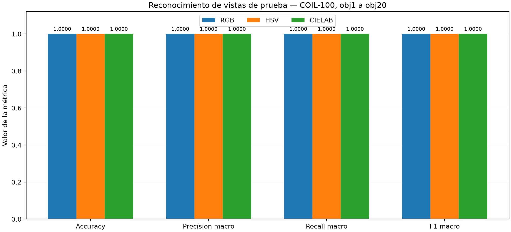

# coil100-color-recognition

Reconocimiento de objetos mediante histogramas de color RGB, HSV y CIELAB, con OpenCV y un clasificador de vecino más cercano (1-NN). Proyecto universitario de visión por computadora, sin redes neuronales.

## Objetivo y método

Comparar los tres espacios para identificar vistas reservadas de **los mismos 20 objetos físicos de COIL-100**. Se utiliza una división determinista e idéntica en los tres experimentos:

| Conjunto | Por objeto | Total |
| --- | ---: | ---: |
| Entrenamiento | 16 vistas | 320 imágenes |
| Prueba | 56 vistas | 1120 imágenes |

Se seleccionan obj1 a obj20, cada uno con 72 vistas separadas por 5°. Las vistas de entrenamiento se distribuyen alrededor de los 360° con índices `floor(i × 72 / 16)`, para `i=0..15`.

Una máscara común separa el objeto del fondo oscuro mediante umbral 40, componente conexo mayor y relleno de huecos. Cada histograma conjunto tiene **8×8×8 = 512 componentes**, normalización L1 y los rangos propios de OpenCV. El 1-NN compara exclusivamente con las 320 referencias train mediante distancia de Bhattacharyya. La distancia no es un porcentaje de confianza.

Tecnologías: Python 3.10+, OpenCV, NumPy, Pillow, Matplotlib y `unittest`.

## Instalación y pruebas en Windows

Desde PowerShell, en la raíz del repositorio:

```powershell
py -3 -m venv .venv
.\.venv\Scripts\python.exe -m pip install -r requirements.txt
.\.venv\Scripts\python.exe -m unittest discover -s tests -v
```

Las **43 pruebas** funcionan sin descargar COIL-100: combinan imágenes sintéticas temporales, fórmulas conocidas y verificaciones de los CSV oficiales incluidos. El inventario contiene solo clases, ángulos, rutas relativas y conjuntos.

En Linux se puede crear el entorno con `python3 -m venv .venv` y sustituir `.\.venv\Scripts\python.exe` por `.venv/bin/python`.

## Obtener y preparar el dataset

Descarga el archivo **processed** desde la [página oficial de COIL-100 de Columbia University](https://www.cs.columbia.edu/CAVE/software/softlib/coil-100.php). Extrae las imágenes en `data/raw/coil-100/`, conservando los nombres originales como `obj1__0.png`. Si el ZIP crea otra carpeta interna, indica con `--dataset-root` la carpeta donde están los PNG.

El dataset y los mosaicos que reproducen sus fotografías **no se redistribuyen**. El código lee los originales sin modificarlos. El inventario incluido conserva la división oficial de este experimento; no es necesario regenerarlo para predecir o evaluar.

Para validar las imágenes y generar un inventario de comprobación separado, sin sobrescribir el oficial:

```powershell
.\.venv\Scripts\python.exe -m src.coil100.prepare --dataset-root data/raw/coil-100 --output data/processed/inventory_check.csv
```

## Predicción individual y evaluación

Estos comandos requieren descargar el dataset:

```powershell
.\.venv\Scripts\python.exe -m src.coil100.recognize --image data/raw/coil-100/obj1__5.png --color-space all
.\.venv\Scripts\python.exe -m src.coil100.evaluate --output-dir artifacts/phase3b_reproduction
```

`--color-space` acepta `RGB`, `HSV`, `CIELAB` o `all`. La predicción devuelve clase, distancia, vecino de entrenamiento y espacio utilizado. `--dataset-root` y `--inventory` permiten cambiar las rutas de entrada. Mantén los parámetros originales al reproducir el experimento.

La evaluación genera 3360 predicciones: 1120 por espacio. El directorio de salida debe estar vacío; los resultados oficiales de `artifacts/phase3b/` se preservan.

## Resultados oficiales

| Espacio | Predicciones | Accuracy | Error | Precision macro | Recall macro | F1 macro |
| --- | ---: | ---: | ---: | ---: | ---: | ---: |
| RGB | 1120 | 100 % | 0 % | 100 % | 100 % | 100 % |
| HSV | 1120 | 100 % | 0 % | 100 % | 100 % | 100 % |
| CIELAB | 1120 | 100 % | 0 % | 100 % | 100 % | 100 % |



Cada matriz de confusión contiene 56 aciertos por clase. Las filas son clases reales y las columnas predichas, en orden obj1 a obj20. Los CSV de predicciones, métricas y matrices, las figuras y la configuración original están en [artifacts/phase3b](artifacts/phase3b/).

## Alcance y verificación

El 100 % corresponde únicamente a vistas reservadas de los mismos objetos físicos, bajo las condiciones de captura de COIL-100. No demuestra reconocimiento de objetos desconocidos ni generalización a fondos, iluminación o instancias diferentes. No hay una ventaja observable de un espacio sobre otro en este protocolo.

Las referencias cercanas en ángulo, la captura controlada y las diferencias de color pueden facilitar la tarea. La segmentación puede perder partes oscuras o incluir fondo en asas; los histogramas no conservan estructura espacial y el clasificador siempre asigna una clase.

Los controles de nombres engañosos conservaron las predicciones. Al permutar las etiquetas de entrenamiento con semilla `20261017`, la exactitud diagnóstica cayó a 2,68 % en RGB y 2,32 % en HSV y CIELAB. No se identificaron fugas en el flujo examinado; estos diagnósticos se conservan separados de los resultados oficiales.

Consulta [la metodología y reproducción](docs/metodologia.md), [el resumen del experimento](docs/resumen_academico.md) y [la verificación independiente](docs/verificacion_independiente.md). Los metadatos históricos conservan hashes de los módulos experimentales originales; la documentación pública se ha editado sin cambiar esos módulos.

## Fuente y atribución

S. A. Nene, S. K. Nayar y H. Murase. *Columbia Object Image Library (COIL-100)*. Technical Report CUCS-006-96, Columbia University, febrero de 1996. [Fuente oficial y documentación](https://www.cs.columbia.edu/CAVE/software/softlib/coil-100.php).

El dataset pertenece a sus titulares y debe obtenerse de la fuente oficial. No se ha asignado una licencia al código de este repositorio; la decisión queda pendiente.
